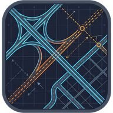
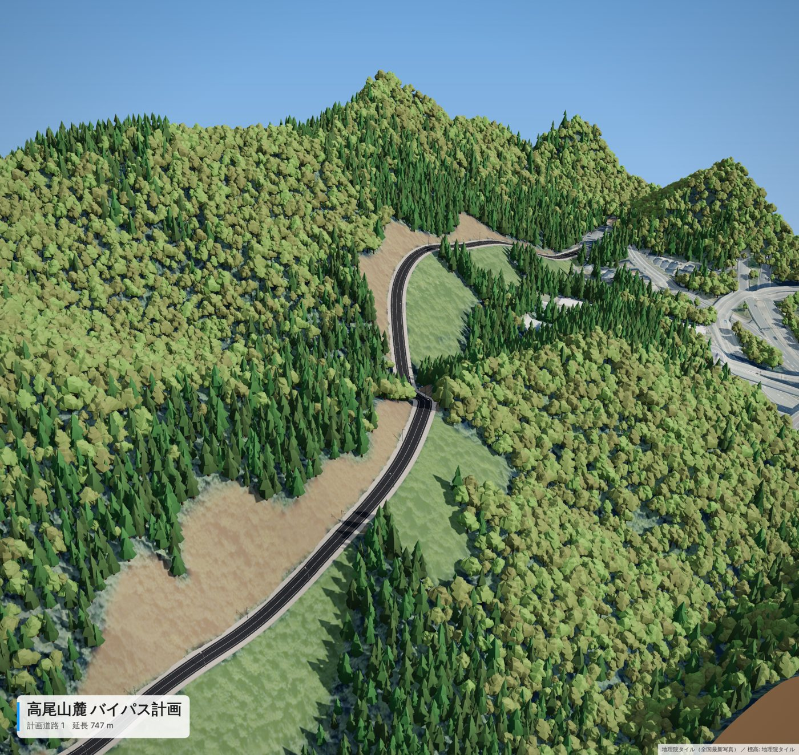
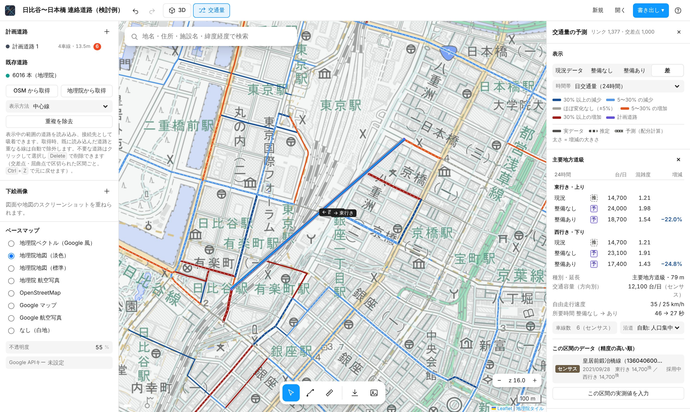

<p align="center"></p>

# Road Plan — 道路計画デザインツール

地図（地理院タイル / 地理院ベクトルタイル / OpenStreetMap / Google / 任意の画像）に重ねて道路の平面線形を描く、ブラウザだけで動くアプリです。
**▶ [アプリを開く（GitHub Pages）](https://cool0707.github.io/road-plan/)**







サーバー・ビルド不要。`index.html` をブラウザで開くだけで動きます（データはブラウザ内にのみ保存）。

## 主な機能

- **場所の検索**: 地名・住所・施設名・緯度経度で検索（国土地理院 住所検索 API + OpenStreetMap Nominatim）
- **線形作図（IP法）**: クリックで IP を置くと、直線 − クロソイド − 円曲線 − クロソイド − 直線 を自動生成。R、A1/A2（非対称可）、L を数値・ドラッグで編集
- **既存道路の読み込み**: OpenStreetMap（Overpass API）/ 国土地理院ベクトルタイル提供実験（道路中心線）。名称・種別・幅員・速度・方位角・延長を表示
- **既存道路の途切れ修正**: 実際はつながっているのに線が途切れている所を、「途切れを修復」で自動でつなぐ（許容距離以内の、どこにもつながっていない端点を他の道路の端点・延長線との交点・前方の最近点まで延ばし、T 字には接続点を入れる）か、`L`「手でつなぐ・描き足す」で端点から経由点をたどって他の道路につなぐ／足りない道路を描き足す。既存道路を選択して端点の ○ をドラッグして他の道路に吸着させることもできる
- **接続**: 端点を既存道路や他の計画道路に吸着。「交差・T字」または「延伸（接線方向に拘束）」
- **片勾配**: IP ごとに片勾配 [%] を設定可能（空欄なら必要片勾配 i = V²/(127R) − f から自動、2%〜最大片勾配。片勾配を付さなくてよい大きな曲線半径は 2% の拝み勾配のまま）。3D の路面・照査（第16条）・すりつけ長（第18条）・合成勾配（第25条）に同じ値を使う
- **照査**: 道路構造令（設計速度・幅員・最小曲線半径・曲線長・片勾配・緩和区間と片勾配のすりつけ・視距・縦断勾配・登坂車線・縦断曲線・横断勾配・合成勾配・交差角）、進入速度と減速距離、位置指定道路（建築基準法施行令 第144条の4）、歩道の縦断勾配（道路移動等円滑化基準）、切土・盛土の のり面勾配（道路土工指針の標準のり面勾配）
- **勾配の上限の条件**: 道路の区分に加えて「地域」（積雪寒冷地域／積雪寒冷の度がはなはだしい地域）と、第3種の「自転車道・自転車歩行者道の有無」を設定すると、最大片勾配（10・8・6%）、縦断勾配の特例値（第1〜3種 +3%・第4種 +2%）、合成勾配（積雪寒冷の度がはなはだしい地域 8%、設計速度 30・20km/h の特例 12.5%）の上限が切り替わる
- **縦断計画（計画高）**: 縦断変化点（VIP）の測点・計画高・縦断曲線長で道路の各地点の高さを決め、盛土・切土を計画。地図下部の縦断図で ● をドラッグして編集。地理院標高タイルの現況地盤と比べて切盛高を表示し、縦断勾配(20条)・縦断曲線(22条)・合成勾配(25条)を照査
- **断面図**: `X`「断面図」で地図上に線（折れ線可）を引くと、地図下部にその線に沿った断面図を表示。3D を開かなくても、現況地盤（地理院 標高タイル）と、線が横切る計画道路の計画高・片勾配の路面、盛土 1:1.5／切土 1:1.0 ののり面、盛土高 8m 超の橋梁を 3D と同じ形で描き、交差する計画道路（測点・計画高・地盤高・切盛高・交差角）と既存道路を注記。カーソル位置の高さを表示して地図に位置を示す。断面線の点はドラッグで移動でき、道路を編集すると自動で更新。縦横同縮尺の切替と CSV 保存に対応
- **3D ビュー**: 上部バーの「3D」で、地理院 標高タイルの地形（航空写真・地図を貼り付け）の上に計画道路を立体表示。計画高・片勾配・切土／盛土のり面・橋梁（盛土高 8m 超）・区画線・歩道・街路灯を自動で作り、マウスで回転・移動・ズーム。高さ強調（〜5 倍）に対応。既存道路も地面に貼り付けず、ならした高さの路盤に置き、曲線部は曲率と速度から片勾配を推定して傾ける
- **絵作り**: 太陽の方位・高度に合わせた空（大気散乱＋雲）と環境光、視点に追従する影、アンビエントオクルージョン、高さで薄くなる霞（大気遠近）、雲の影、ブルーム、フィルム調トーンマッピング。詳細範囲の外側も半径 13〜22km まで地形と写真をつなぎ、地平線まで描く。画質は 高／標準／軽量 から選択
- **建物・水面**: 地理院 最適化ベクトルタイルの建物外形を押し出し（住宅は切妻屋根、ほかは陸屋根。窓などの模様は描かず、色は航空写真のその場所の色、写真がなければ灰色）、水域は空を映す水面に。建物の高さは OpenStreetMap に登録された実測値（PLATEAU から取り込まれた高さ・階数を含む）を使い、無い建物だけ種別・面積から推定（画面右下に実測・推定の棟数を表示）。計画道路・のり面にかかる建物は取り除く
- **木（森）の生成**: 航空写真の緑の度合いと樹冠の肌理から森を自動判定するか、3D 上をブラシでなぞって範囲を塗る／消すと、スギ・ヒノキの群と広葉樹を密度・樹高・色にむらを付けて植える（ジッター格子＋値ノイズ、葉むらのカードを重ねた樹形を InstancedMesh で最大 6 万本、色は写真の色合いに寄せる）。道路・のり面・既存道路・建物・水面の上には植えない
- **交通量の予測（整備あり・なしの比較）**: 上部バーの「交通量」で、既存道路と計画道路をネットワークにして、計画道路の有無による交通量・混雑度（交通量 ÷ 交通容量）・所要時間の変化を予測。道路交通センサス・常時観測・自治体の調査・自分の実測値を精度の高い順に使い、データの無い道路は地区の属性から推定。OD の推定 3 通り × 配分 5 通り、時間帯 6 通りを選べる（下の「交通量の予測」を参照）
- **計画検討（土工・用地・交差・事業費・B/C・騒音・災害リスク・比較表）**: 上部バーの「検討」で、線形の照査とは別に計画段階で確認する項目を計算（下の「計画検討」を参照）
- **スクリーンショット**: 「高画質で撮影」で、影 8192px の高解像度 PNG（画面の 2 倍 / FHD / 4K / 正方形、タイトル・出典入り）を保存
- **下絵画像**: 図面や地図画像を移動・回転・拡縮して重ね、2 点間の実距離で縮尺合わせ
- **書き出し**: PDF（平面図＋線形計算書＋縦断図・縦断計算＋照査結果）/ プロジェクト JSON / GeoJSON / 線形計算書 CSV / DXF

## 使い方

1. [GitHub Pages 版](https://cool0707.github.io/road-plan/) を開く（ローカルでは `index.html` を直接開くか、任意の静的サーバーで配信）
2. 左パネル「OSM から取得」または「地理院から取得」で表示範囲の既存道路を読み込む
3. `P` で道路を描く → 既存道路上をクリックして接続 → ダブルクリックで確定
4. 右パネル一番上の「幅員・車線数」で車線数（−／＋）・車線幅・路肩・歩道を設定（地図上と左の一覧にも「4車線・13.5m」のように表示）
5. IP を選択して右パネルで R・A を調整
6. 右パネル「縦断計画（計画高）」の「現況地盤に沿う案」で計画縦断を作り、縦断図で計画高（盛土・切土）を調整
7. 「照査」タブで適合を確認

## 交通量の予測

計画道路の混雑緩和の効果を、整備なし・整備ありで比べます。

1. 計画道路のまわりの既存道路を、迂回路になりうる範囲まで読み込む（一方通行・車線数が入っている OpenStreetMap を推奨。地理院の道路中心線は一方通行の情報が無いため、上下線が別々の線の道路は区間の交通量を等分して扱います）
2. 上部バーの **交通量** → 右パネルの **センサスを取得**（必要なら **常時観測を取得**・**ファイルを取り込む**・**観測地点を追加**）
3. 計画道路を描くと、**整備なし／整備あり／差** を地図と表で比較できます。区間をクリックすると方向別の値・使っているデータ・候補が出ます

### 交通量データと優先順位

同じ区間に複数のデータがあるときは、上から順に使います（区間をクリックすると手で選び直せます）。

| 優先 | データ | 入手方法 | 扱い |
|---|---|---|---|
| 1 | 実測（現地観測） | 「観測地点を追加」→ 地図の道路をクリック → 地図下の表に方向別の台数を入力（<kbd>Enter</kbd> で下のセル、Excel からの貼り付け可、印はドラッグで移動） | 実データ |
| 2 | 常時観測（国土交通省 交通量API。直轄国道など約 2,600 か所の機械観測、上り・下り別の 1 時間値、過去 3 か月） | 「常時観測を取得」。API がブラウザからの直接の読み出し（CORS）を許可していないため、表示されるリンクを開いて保存したファイルを取り込みます | 実データ |
| 3 | 自治体等の調査 | CSV・GeoJSON を取り込む（「CSV の見本」参照。列: 地点名・緯度・経度・方位・調査日・時間帯・方向1台数・方向2台数・大型車混入率。合計だけの列も可。Shift_JIS 可） | 実データ |
| 3 | 道路交通センサス R3（令和3年度 全国道路・街路交通情勢調査 一般交通量調査）の観測区間 | 「センサスを取得」（同梱データ） | 実データ |
| 4 | 同 非観測区間（国交省による推定値） | 同上 | 推定 |
| 5 | 道路種別・車線数・沿道状況（地区の属性）からの推定 | 自動。全国のセンサス実測区間 約 6 万の中央値（種別 × 沿道状況 × 車線数ごとの 1 車線あたり交通量）を、近くの観測値との比で補正 | 推定 |

- **見分け方**: 実データ＝実線・「実」、推定＝破線・「推」、配分計算による予測＝中央に白い点線・「予」。別の時間帯の値から換算した値には「換」が付き、表では薄い斜体で出ます。右パネルに、延長のうち実データ・推定がどれだけかを帯で表示します
- **時間帯**: 日交通量（24時間）／昼間12時間（7〜19時）／ピーク時／朝ピーク／夕ピーク／夜間12時間。無い時間帯は昼夜率・ピーク率（その区間の値、無ければ全国の中央値）で換算します
- **沿道状況（地区の属性）**: 人口集中地区（DID）・商業地域／DID／その他市街部／平地部／山地部。センサス区間の値 → 近くのセンサス区間 → 道路密度からの推定 の順に自動で決まり、区間ごと・全体で指定もできます
- **交通容量**: センサス区間は「交通量 ÷ 混雑度」（国交省の算定値）、それ以外は全国の中央値（種別 × 沿道状況 × 車線数）

### 予測の方法

出入口（読み込み範囲の縁で切れている道路）の方向別交通量を、流入＝発生・流出＝集中として OD 表を作り、計画道路なし・ありのネットワークに配分します。

- **OD の推定**: リンク観測交通量による補正（重力モデルの OD 表を、観測のある全断面の方向別交通量に合うよう繰り返し補正する OD 逆推定。既定）／重力モデル（発生・集中の二重制約、フレーター法と同じ収束計算）／比例配分
- **配分**: 利用者均衡配分（Frank–Wolfe 法。既定）／分割配分法／確率的配分（ロジット・Dial 法）／最短経路配分／転換率法（所要時間比 P = 1/(1+比^κ)）。リンク所要時間は BPR 関数 t = t₀(1 + α(Q/C)^β)（既定 α = 0.48, β = 2.82）
- 伸び率（将来交通量の倍率）、対象道路（一般道以上／幹線のみ／すべて）、域内の発生量、高速道路を含めるか、計画道路の旅行速度・平面交差の有無を設定できます
- **現況の再現性**（観測値と配分値の散布図・相関係数・RMSE）を必ず確認してください。結果は書き出し ▾ の CSV と PDF（予測結果のページ）に出ます

需要は固定（誘発交通・公共交通への転換・信号制御は扱いません）。読み込んだ範囲の道路だけで作る簡易な予測なので、事業評価には交通量調査と道路管理者の基準による検討が別途必要です。

## 計画検討

上部バーの **検討** を押すと、選択中の計画道路について次の項目を計算し、「不適合・要確認・参考・適合」の一覧と数量で示します。計画道路を描き直すと自動で計算し直し、**比較表** で計画道路どうしを同じ項目で並べられます。

| 項目 | 内容 | 使うデータ・根拠 |
|---|---|---|
| 土工 | 横断ごと（約 10m ピッチ）の切土・盛土の断面積 → 平均断面法の土量、切土の盛土への流用（土量変化率 C）・不足土・残土、土積図、のり面積、橋梁区間（盛土高 8m 超） | 地理院 標高タイル、盛土 1:1.5／切土 1:1.0（断面図・3D と同じ） |
| 用地・支障物件 | 用地面積・用地幅（のり尻・のり肩＋余裕幅）、用地にかかる建物の棟数・面積、水域の横断 | 地理院 最適化ベクトルタイルの建物外形・水域 |
| 交差・接続 | 途中で横切る道路ごとの測点・交差角・高低差、平面交差／立体交差（桁下 4.5m＋桁高）／不成立の判定、平面交差の間隔 | 読み込んだ既存道路・他の計画道路、道路構造令 第12条・第27条 |
| 区分・車線数 | 道路の種類・地形・計画交通量から該当する級と必要な車線数。中央帯・植樹帯・曲線部の拡幅が要る区分の指摘 | 道路構造令 第3条・第5条（設計基準交通量。交差点の多い第4種は ×0.8・×0.6）・第6条・第11条の4・第17条 |
| 概算事業費 | 土工・のり面・舗装・橋梁・排水等・用地・建物補償の数量 × 単価 ＋ 諸経費・測量設計費 | 単価は画面で変更（既定値は桁を見るための仮の値） |
| 費用便益分析 | 走行時間短縮・走行経費減少・交通事故減少便益、事業費・維持管理費の現在価値、B/C・純現在価値・EIRR、感度分析（交通量・事業費・事業期間） | 交通量の予測（日交通量の整備なし・あり）、国土交通省 道路局・都市局「費用便益分析マニュアル」（令和7年8月・令和6年価格）の算定式と原単位、割引率 4%（参考 2%・1%）・検討年数 50 年 |
| 沿道騒音 | 道路端の等価騒音レベル（昼 6〜22時・夜 22〜6時）、環境基準以下になる距離 | ASJ RTN-Model（2 車種分類のパワーレベル式）、騒音に係る環境基準 |
| 災害リスク | 洪水・高潮・津波の浸水想定区域、土砂災害警戒区域（土石流・急傾斜地の崩壊・地すべり）を地図に重ね、中心線が通る延長 | 国土交通省 ハザードマップポータルサイトのオープンデータ（タイル） |
| 比較表 | 計画道路どうしを延長・線形・照査・土工・用地・交差・事業費・交通量・騒音・B/C で比較（「比較案として 1 路線ずつ評価」で路線ごとの B/C） | 上記の結果 |

- 縦断計画（計画高）が無い道路は、現況地盤をならした高さを仮の計画高として土工を計算し、交差の高低差は判定しません。先に縦断計画を作ってください
- 費用便益分析は、先に **交通量** の画面でセンサスなどのデータを読み込み、現況の再現性を確認してから使います。便益は供用開始から 50 年間同じ額が続くとし、交通事故は中央帯の有無を考慮しない式（マニュアル 表−4）を使います
- 結果は 書き出し ▾ の「計画検討の結果 (.csv)」と PDF（計画検討のページ）に出ます
- 住民合意・景観・文化財・用途地域や保安林などの法規制のように機械的に計算できない項目は扱いません。数量・事業費・便益・騒音は概略値で、事業評価・環境影響評価には所定の調査と手法による検討が別途必要です

### 同梱データの作り方（センサス）

国交省の公開ページはブラウザからの直接の読み出しを許可していない（CORS のヘッダーが無い）ため、センサスの区間データはこのリポジトリに同梱します（`data/census-r3/`）。**全国 47 都道府県の 99,067 区間**（箇所別基本表 99,417 区間のうち、WEB マップに形状のあるもの）を約 20km 四方のタイル 2,087 枚（計 約 41MB）に分けてあり、「センサスを取得」は表示範囲のタイルだけを読み込みます。全国の集計から作る原単位表（`js/trafficmodel.js`）も同梱済みです。データを作り直すときは次の手順です（全国で約 10 万回のアクセス・1 時間ほど。取得済みのファイルは飛ばします）。

```
tools/census-fetch.sh <保存先> [都道府県コード...]   # 箇所別基本表・時間帯別交通量表 CSV と区間形状を取得（引数なしで全国 約 10 万区間）
node tools/census-build.mjs --csv <保存先>/csv --geom <保存先>/geom
```

出典: 国土交通省「令和3年度 全国道路・街路交通情勢調査 一般交通量調査」（箇所別基本表・時間帯別交通量表・一般交通量調査結果 WEB マップ）を加工して作成。常時観測は「国土交通省 交通量API機能による交通量（参考値）」で、このアプリは交通量API機能を使用していますが、内容は国土交通省によって保証されたものではありません。

ベースマップ「地理院ベクトル（Google 風）」は国土地理院の最適化ベクトルタイルを MapLibre GL で Google マップ風の配色に描画します（WebGL 必須。PDF の背景は淡色ラスタで代用）。

Google マップを背景にするには Google Maps Platform の **Map Tiles API** キーを左パネルに入力します。

## 注意

3D ビューの建物の高さは、OpenStreetMap に高さ・階数が登録されている建物だけが実測値（[OpenFreeMap](https://openfreemap.org/) のベクトルタイル経由、© OpenStreetMap contributors）で、それ以外は推定です。景観検討の目安として使ってください。

照査は道路構造令本則の表と「道路構造令の解説と運用」の一般的な目安に基づく簡易チェックです（普通道路のみ。小型道路の基準値には対応していません）。片勾配すりつけ率・片勾配を付さない曲線半径・のり面勾配などの「目安」と表示される項目は、解説と運用・道路土工指針の原本で確認してください。
条例・道路管理者基準・特例値の適用条件は別途確認してください。座標は最初の作図位置を原点とするローカル平面座標（m）です。

## 開発

`main` へ push すると GitHub Actions（`.github/workflows/pages.yml`）がテスト後に GitHub Pages へ自動デプロイします。

```
node --test test/geom.test.js test/city.test.js test/traffic.test.js test/xsec.test.js test/study.test.js
```

構成: `js/geom.js`（線形計算）, `js/rules.js`（基準値と照査）, `js/app.js`（地図・描画・ツール）, `js/panels.js`（UI・入出力）, `js/report.js`（PDF 用レポート）, `js/search.js`（地名・住所検索）, `js/vectorstyle.js`（ベクトル地図のスタイル）, `js/view3d.js`（3D ビュー・撮影）, `js/v3d-fx.js`（空・大気・ポスト処理・シェーダー拡張）, `js/v3d-city.js`（ベクトルタイルの建物・水域、建物の高さ）, `js/traffic.js`（交通量の予測: ネットワーク・OD 推定・配分）, `js/trafficui.js`（交通量の画面・データの取得と取り込み）, `js/trafficmodel.js`（全国のセンサスから作った原単位表。`tools/census-build.mjs` が生成）, `js/study.js`（計画検討の計算: 土工・用地・交差・区分と車線数・事業費・費用便益・騒音）, `js/studyui.js`（計画検討の画面・比較表・ハザードマップの取得）, `data/census-r3`（センサスの区間データ）, `vendor/leaflet`（Leaflet 1.9.4）, `vendor/maplibre`（MapLibre GL JS 5.24.0 + maplibre-gl-leaflet 0.1.4、ベクトル地図・既存道路の描画時に読み込み）, `vendor/three`（three.js r180 + OrbitControls を 1 ファイルにまとめたもの、3D ビューを開いたときに読み込み）
