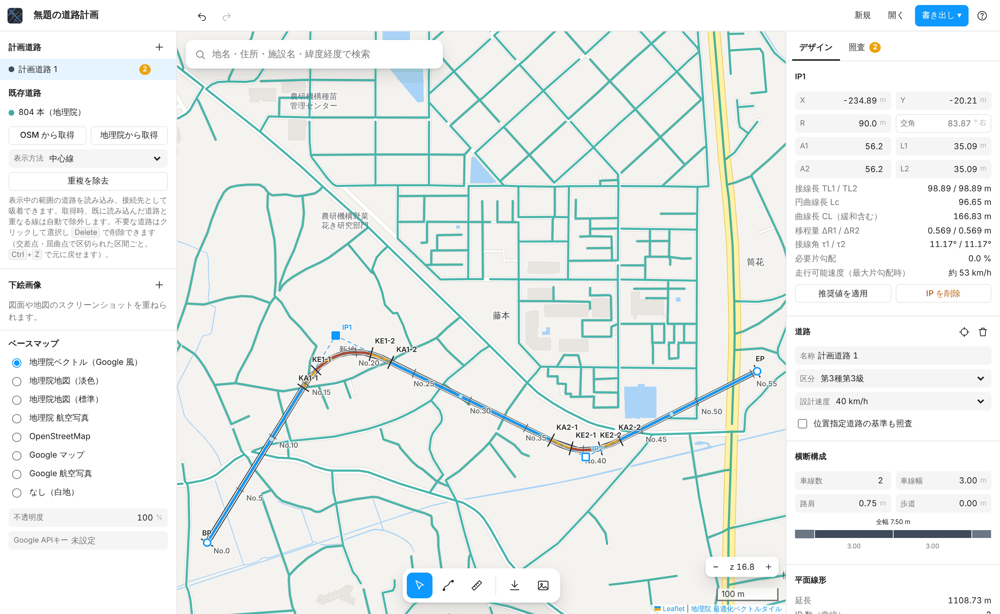
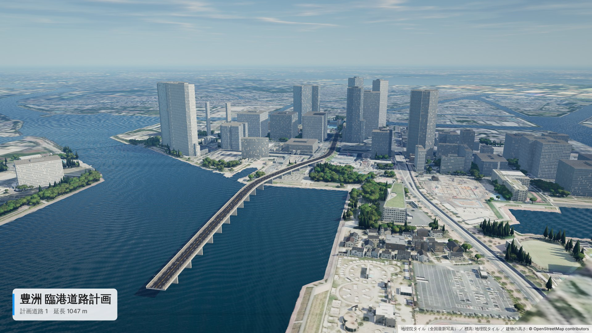

<p align="center"></p>

# Road Plan — 道路計画デザインツール

地図（地理院タイル / 地理院ベクトルタイル / OpenStreetMap / Google / 任意の画像）に重ねて道路の平面線形を描く、ブラウザだけで動くアプリです。
**▶ [アプリを開く（GitHub Pages）](https://cool0707.github.io/road-plan/)**






サーバー・ビルド不要。`index.html` をブラウザで開くだけで動きます（データはブラウザ内にのみ保存）。

## 主な機能

- **場所の検索**: 地名・住所・施設名・緯度経度で検索（国土地理院 住所検索 API + OpenStreetMap Nominatim）
- **線形作図（IP法）**: クリックで IP を置くと、直線 − クロソイド − 円曲線 − クロソイド − 直線 を自動生成。R、A1/A2（非対称可）、L を数値・ドラッグで編集
- **既存道路の読み込み**: OpenStreetMap（Overpass API）/ 国土地理院ベクトルタイル提供実験（道路中心線）。名称・種別・幅員・速度・方位角・延長を表示
- **接続**: 端点を既存道路や他の計画道路に吸着。「交差・T字」または「延伸（接線方向に拘束）」
- **照査**: 道路構造令（設計速度・幅員・最小曲線半径・曲線長・片勾配・緩和区間・視距・縦断勾配・交差角）、進入速度と減速距離、位置指定道路（建築基準法施行令 第144条の4）
- **縦断計画（計画高）**: 縦断変化点（VIP）の測点・計画高・縦断曲線長で道路の各地点の高さを決め、盛土・切土を計画。地図下部の縦断図で ● をドラッグして編集。地理院標高タイルの現況地盤と比べて切盛高を表示し、縦断勾配(20条)・縦断曲線(22条)・合成勾配(25条)を照査
- **3D ビュー**: 上部バーの「3D」で、地理院 標高タイルの地形（航空写真・地図を貼り付け）の上に計画道路を立体表示。計画高・片勾配・切土／盛土のり面・橋梁（盛土高 8m 超）・区画線・歩道・街路灯を自動で作り、マウスで回転・移動・ズーム。高さ強調（〜5 倍）に対応
- **絵作り**: 太陽の方位・高度に合わせた空（大気散乱＋雲）と環境光、視点に追従する影、アンビエントオクルージョン、高さで薄くなる霞（大気遠近）、雲の影、ブルーム、フィルム調トーンマッピング。詳細範囲の外側も半径 13〜22km まで地形と写真をつなぎ、地平線まで描く。画質は 高／標準／軽量 から選択
- **建物・水面**: 地理院 最適化ベクトルタイルの建物外形を押し出し（住宅は切妻屋根、ビルは窓割り・陸屋根・塔屋）、水域は空を映す水面に。建物の高さは OpenStreetMap に登録された実測値（PLATEAU から取り込まれた高さ・階数を含む）を使い、無い建物だけ種別・面積から推定（画面右下に実測・推定の棟数を表示）。計画道路・のり面にかかる建物は取り除く
- **木（森）の生成**: 航空写真の緑の度合いと樹冠の肌理から森を自動判定するか、3D 上をブラシでなぞって範囲を塗る／消すと、スギ・ヒノキの群と広葉樹を密度・樹高・色にむらを付けて植える（ジッター格子＋値ノイズ、葉むらのカードを重ねた樹形を InstancedMesh で最大 6 万本、色は写真の色合いに寄せる）。道路・のり面・既存道路・建物・水面の上には植えない
- **スクリーンショット**: 「高画質で撮影」で、影 8192px の高解像度 PNG（画面の 2 倍 / FHD / 4K / 正方形、タイトル・出典入り）を保存
- **下絵画像**: 図面や地図画像を移動・回転・拡縮して重ね、2 点間の実距離で縮尺合わせ
- **書き出し**: PDF（平面図＋線形計算書＋縦断図・縦断計算＋照査結果）/ プロジェクト JSON / GeoJSON / 線形計算書 CSV / DXF

## 使い方

1. [GitHub Pages 版](https://cool0707.github.io/road-plan/) を開く（ローカルでは `index.html` を直接開くか、任意の静的サーバーで配信）
2. 左パネル「OSM から取得」または「地理院から取得」で表示範囲の既存道路を読み込む
3. `P` で道路を描く → 既存道路上をクリックして接続 → ダブルクリックで確定
4. 右パネル一番上の「幅員・車線数」で車線数（−／＋）・車線幅・路肩・歩道を設定（地図上と左の一覧にも「4車線・13.5m」のように表示）
5. IP を選択して右パネルで R・A を調整
6. 右パネル「縦断計画（計画高）」の「現況地盤に沿う案」で計画縦断を作り、縦断図で計画高（盛土・切土）を調整
7. 「照査」タブで適合を確認

ベースマップ「地理院ベクトル（Google 風）」は国土地理院の最適化ベクトルタイルを MapLibre GL で Google マップ風の配色に描画します（WebGL 必須。PDF の背景は淡色ラスタで代用）。

Google マップを背景にするには Google Maps Platform の **Map Tiles API** キーを左パネルに入力します。

## 注意

3D ビューの建物の高さは、OpenStreetMap に高さ・階数が登録されている建物だけが実測値（[OpenFreeMap](https://openfreemap.org/) のベクトルタイル経由、© OpenStreetMap contributors）で、それ以外は推定です。景観検討の目安として使ってください。

照査は道路構造令本則の表と「道路構造令の解説と運用」の一般的な目安に基づく簡易チェックです。
条例・道路管理者基準・特例値の適用条件は別途確認してください。座標は最初の作図位置を原点とするローカル平面座標（m）です。

## 開発

`main` へ push すると GitHub Actions（`.github/workflows/pages.yml`）がテスト後に GitHub Pages へ自動デプロイします。

```
node --test test/geom.test.js test/city.test.js
```

構成: `js/geom.js`（線形計算）, `js/rules.js`（基準値と照査）, `js/app.js`（地図・描画・ツール）, `js/panels.js`（UI・入出力）, `js/report.js`（PDF 用レポート）, `js/search.js`（地名・住所検索）, `js/vectorstyle.js`（ベクトル地図のスタイル）, `js/view3d.js`（3D ビュー・撮影）, `js/v3d-fx.js`（空・大気・ポスト処理・シェーダー拡張）, `js/v3d-city.js`（ベクトルタイルの建物・水域、建物の高さ）, `vendor/leaflet`（Leaflet 1.9.4）, `vendor/maplibre`（MapLibre GL JS 5.24.0 + maplibre-gl-leaflet 0.1.4、ベクトル地図・既存道路の描画時に読み込み）, `vendor/three`（three.js r180 + OrbitControls を 1 ファイルにまとめたもの、3D ビューを開いたときに読み込み）
